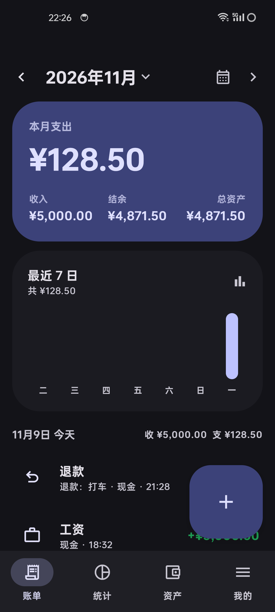
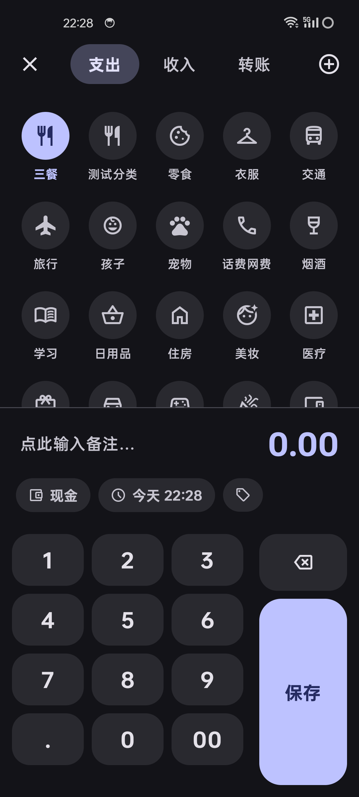
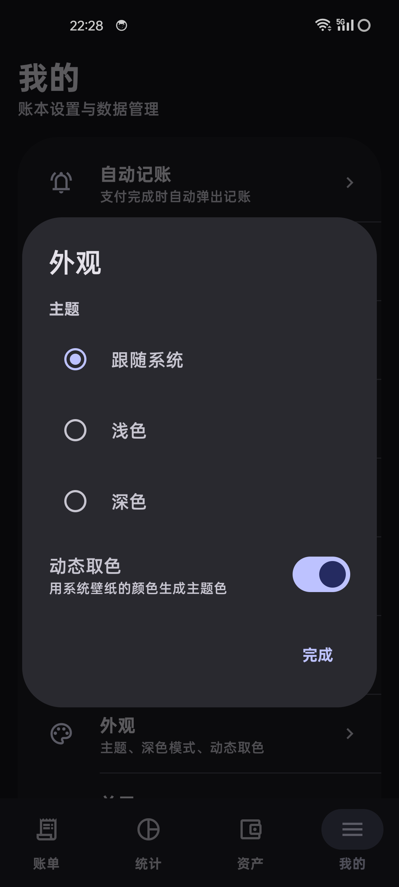

<div align="center">






# 量入为出 · Within

**一个不联网的个人记账应用。支付完成时自动弹出记账，你只需要点确认。**

[](LICENSE)


</div>

---

## 这是一个什么样的应用

**量入为出（Within）** 是一款个人记账应用。它和「钱迹」这类产品瞄准同一件事：把每天的收支记清楚，然后让你看清钱去了哪里。

它有两处不同：

1. **没有账号、没有服务器、没有云同步。** 所有数据存在你自己的手机上，代码全在这里，可以自己编译。
2. **支付完成后自动记账。** 你在微信、支付宝、淘宝、外卖应用完成支付，应用会弹出一张已经填好金额、账户、分类、备注的卡片，你只需要点「确认」。不满意的地方可以当场改。

## 功能

| 模块 | 状态 |
|---|---|
| 记一笔（支出 / 收入 / 转账） | 已完成 |
| 首页月度汇总、最近 7 日柱状图、按日分组账单 | 已完成 |
| 账单详情、删除 | 已完成 |
| 退款（部分 / 全额、多次、可撤销） | 已完成 |
| 日历视图 | 已完成 |
| 统计（分类排行、占比） | 已完成 |
| 资产（多账户、净资产） | 已完成 |
| 账户管理（增删改、类型、余额） | 已完成 |
| 分类管理（增删改、二级分类、图标） | 已完成 |
| 导入钱迹 XLSX / CSV（转账双账户、退款关联、去重、批次撤销） | 已完成 |
| 整库备份与恢复 | 已完成 |
| 自动记账（通知监听 + 无障碍） | 已完成 |
| Material 3 Expressive 主题、深色模式、动态取色 | 已完成 |
| 预算 / 周期记账 / 标签 / 多账本 / 报销 / 小组件 / 密码保护 | 计划中 |

## 自动记账是怎么工作的

应用开了两条互相独立的检测线，任一条命中就会生成一张待确认的草稿：

1. **通知监听**（推荐）：读微信、支付宝、淘宝、京东、美团、饿了么、拼多多的支付通知，从文本里解析金额、收支方向和收款方。
2. **无障碍服务**（兜底）：通知被折叠或关闭时，直接在支付结果页上读「支付成功」这类强信号和金额。

草稿会弹在屏幕底部，金额、账户、分类、备注都已经填好。点「确认」才真的记账，点「忽略」就丢弃。

需要三个权限：通知使用权、无障碍服务、悬浮窗。

想先看看效果？设置里有「触发一次测试」，会生成一张 ¥28.80 的模拟草稿，不会真的记账。

**已知限制：**

- 解析基于规则（正则 + 关键词），没有用模型。不同机型、不同版本的微信/支付宝通知文案可能不一样，遇到没识别出来的情况，欢迎提 issue 并附上通知全文。
- 只覆盖中国大陆常用支付应用。其它应用可以走无障碍那条线，但不保证。
- 支付密码、验证码、银行类应用不在监听范围内，也不应该被自动处理。

## 从钱迹迁移

钱迹现在只导出 XLSX 和 JSON，所以这里直接读 XLSX，不用先转 CSV：

1. 钱迹 → 设置 → 导出账单 → 选 XLSX
2. 把文件放到手机上能找到的位置
3. 本应用 → 我的 → 导入账单 → 选那个 xlsx

导入时会：

- 按表头名认列，19 列原名表头直接可用
- 转账同时记转出和转入两个账户
- 退款关联到原账单，冲抵支出而不是重复扣款
- 时间、金额、账户、类型都相同的行自动跳过，同一个文件导两次不会翻倍
- 失败的行会列出原因和行号，不会静默丢弃
- 导入完成后可以一键撤销

## 技术栈

| 项 | 版本 |
|---|---|
| Kotlin | AGP 9 内置 |
| AGP | 9.5.1 |
| Gradle | 9.9 |
| Compose BOM | 2026.09.00（Compose 1.12） |
| Material3 | 1.5.0-rc01，官方 Expressive API |
| Room | 2.8.5 |
| compileSdk / targetSdk / minSdk | 37 / 37 / 26 |

几个实现上的选择：

- **金额一律用 `Long` 存「分」**，不碰浮点，避免 0.1 + 0.2 这类误差。
- **图标用 Material Symbols 可变字体的 ligature**，不打包上千个 vector。
- **写账单和改账户余额在同一个事务里**，不会出现「账单记了但余额没动」。
- **退款不计入收入，而是冲抵支出**（和钱迹一致），否则收入会虚高。

## 构建

需要 JDK 21、Android SDK（platform 37 / build-tools 37）和项目自带的 Gradle wrapper。

```bash
# 调试包
./gradlew :app:assembleDebug

# 发布包（未签名）
./gradlew :app:assembleRelease

# 签名
apksigner sign --ks your.jks --out Within-1.0.0.apk \
  app/build/outputs/apk/release/app-release-unsigned.apk
```

如果 Maven Central 在你那里很慢，`settings.gradle.kts` 里已经配好了阿里云镜像，可以按需删改。

## 参与翻译

界面文案全部外置在 `app/src/main/res/values/strings.xml`，语言文件放在 `values-<语言代码>/strings.xml`。目前有简体中文（默认）和英文。

添加一种语言只需要三步，详见 [docs/TRANSLATING.md](docs/TRANSLATING.md)：

1. 复制 `values/strings.xml` 到 `values-xx/strings.xml`
2. 逐条翻译（`%1$s`、`%1$d` 这类占位符保持原样）
3. 提 PR

## 许可

[Apache License 2.0](LICENSE)

第三方组件许可见 [NOTICE](NOTICE)。
